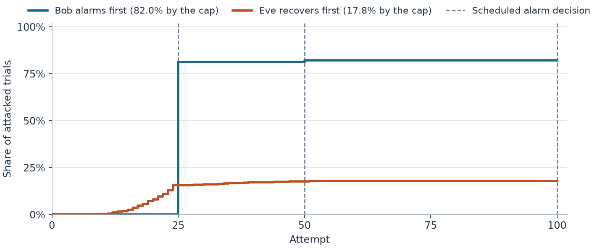
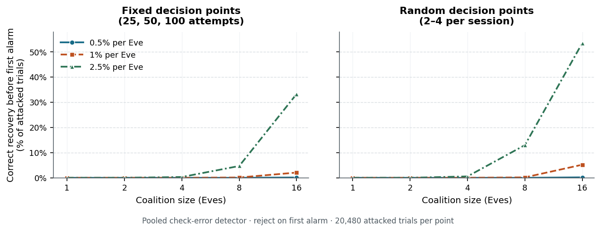

# Quantum eavesdropping detection studies

ECSE 6969 final project · Andrew Napieraj and Ian Chuang

## Run All

Use the same `requirements.txt` for all three notebooks and the validation scripts. From the repository root, install the dependencies and launch Jupyter.

```sh
python -m pip install -r requirements.txt
python -m jupyterlab
```

Open a notebook, edit the first code cell if needed, and choose **Run All**. The figures appear directly under the cells that produce them.

[Glossary of settings, metrics, and result columns](validation/MODEL_NOTES.md#glossary)

| Notebook | Figures you get |
| --- | --- |
| [BB84](BB84.ipynb) | Detection with one final alarm decision or several scheduled decisions, for QBER, U2, and U4. Zero interception gives the held-out false-alarm rate. |
| [QFT repeated secret](QFT_Repeated_Secret.ipynb) | False alarms, recovery, and bit confidence, plus an X-only coalition comparison of fixed and random alarm looks and Bob's response to interim alarms. |
| [Gate baseline](Gate_Baseline.ipynb) | Wrong-outcome rates for each X/H round trip and its same-state control. The default runs locally in Aer. |

## Study scope

BB84 and QFT start with the Erven reference noise rates. The BB84 notebook offers a broader sweep in its first cell. The QFT notebook starts with two Eves using different basis biases and compares pooled check errors with the block check-pattern score. It uses the published two-pass circuit and the proposal's repeated four-bit secret. [Methods and deliverable map](validation/MODEL_NOTES.md#proposal-deliverables)

## QFT alarm-response results

The X-only sweep tested 300 attack settings with 1,024 trials each and a 100-attempt cap. Bob either rejected the key at his first threshold crossing or treated interim crossings as noise, cleared his evidence, and kept the same key. In both cases a final crossing or key mismatch rejected the key. The fixed schedule makes decisions at attempts 25, 50, and 100. The random schedule draws 2–4 decision points per trial, including attempt 100. [Full sweep data](results/qft_alarm_policy_sweep.csv)

| Alarm decisions | Detector | Bob's response | Noise-only trials rejected by alarm | Attacked trials with exposed acceptance | Exposed keys / accepted sessions |
| --- | --- | --- | ---: | ---: | ---: |
| Fixed | Pooled check errors | Reject on alarm | 4.95% | 0.37% | 1,134 / 96,134 |
| Fixed | Pooled check errors | Reset after an interim alarm | 1.07% | 6.11% | 18,766 / 137,849 |
| Fixed | Joint-check surprisal | Reject on alarm | 5.02% | 0.37% | 1,142 / 95,448 |
| Fixed | Joint-check surprisal | Reset after an interim alarm | 1.08% | 6.11% | 18,770 / 137,137 |
| Random | Pooled check errors | Reject on alarm | 4.99% | 0.54% | 1,668 / 95,649 |
| Random | Pooled check errors | Reset after an interim alarm | 0.92% | 6.57% | 20,185 / 153,024 |
| Random | Joint-check surprisal | Reject on alarm | 4.97% | 0.56% | 1,714 / 95,216 |
| Random | Joint-check surprisal | Reset after an interim alarm | 0.96% | 6.57% | 20,190 / 152,528 |

Each row uses 20,480 held-out noise-only trials and 307,200 attacked trials. Both responses use the same trials. Dismissing interim alarms reduces rejections due to noise and lets more exposed keys pass the final decision.

### When do Bob and Eve reach their first outcome?



This setting uses two-qubit blocks, Erven reference noise, and 16 X-only Eves intercepting 2.5% of qubits per Eve per leg. Bob uses pooled check errors and rejects on alarm. Each line counts trials where that outcome occurred first by the indicated attempt. Bob wins a same-attempt tie. In **159 of the 182 trials where Eve recovered first**, she did so before Bob's first scheduled decision.

### How does coalition size affect recovery?



Each point combines 20,480 attacked trials across both block sizes and all ten noise profiles, using pooled check errors. As the number of Eves increases, so does the chance at least one Eve intercepts a given qubit on a leg.

## Proposal setting results

The sweep uses the ten distinct noise pairs in §2 of the proposal. These include zero noise and balanced or 90%-skewed rates at 1%, 2%, and 4% mean noise. The Erven pair `(0.002, 0.038)` is the 2% mean case with higher errors in the X basis. Percentages in the tables average the included settings. The bundle contains the individual results and a self-contained QFT runner. From the extracted folder, run `python qft_runner/run.py` in the study’s Python environment. [Proposal setting data and runner](results/proposal_setting_results.zip)

### QFT repeated secret

The run covers **1,080 attack settings and 20 noise-only controls** across two- and four-qubit blocks. A coalition has 1, 2, or 4 Eves sharing a configured intercept probability of 0.5%, 1%, or 2.5%, a Z-basis probability of 0.1, 0.5, or 0.9, and a per-signal basis redraw probability of 0.1 or 1. Each Eve samples her own interception events. Each attack setting uses 256 trials, and each control uses 1,024 held-out trials.

QFT uses known channel rates for the likelihoods and fits each alarm rule on 1,000 or 10,000 noise-only paths. Bob makes one alarm decision at the full retained-check budget or up to three at 25%, 50%, and 100% of that budget, rounded up to a whole check. At each decision he uses all checks collected so far. The 100-attempt study makes decisions at attempts 25, 50, and 100, with four retained checks per attempt. Eve updates her posterior after each complete attempt, and Bob wins a same-attempt tie. Columns give **pooled check errors / joint-check surprisal**.

| Budget | Bob can alarm after | Fit paths | Noise-only alarms | Bob alarmed first | Eve recovered first |
| --- | --- | ---: | ---: | ---: | ---: |
| 20 checks | 20 checks | 1,000 | 4.97% / 4.85% | 14.84% / 15.14% | 0% / 0% |
| 20 checks | 20 checks | 10,000 | 5.06% / 5.12% | 14.97% / 15.58% | 0% / 0% |
| 20 checks | 5, 10, or 20 checks | 1,000 | 5.09% / 5.25% | 13.64% / 14.41% | 0% / 0% |
| 20 checks | 5, 10, or 20 checks | 10,000 | 5.12% / 5.25% | 13.74% / 14.46% | 0% / 0% |
| 50 checks | 50 checks | 1,000 | 4.78% / 4.82% | 21.93% / 22.75% | 0% / 0% |
| 50 checks | 50 checks | 10,000 | 4.89% / 4.94% | 22.28% / 23.15% | 0% / 0% |
| 50 checks | 13, 25, or 50 checks | 1,000 | 5.03% / 5.03% | 20.45% / 20.79% | 0% / 0% |
| 50 checks | 13, 25, or 50 checks | 10,000 | 4.91% / 5.01% | 20.38% / 20.94% | 0% / 0% |
| 100 checks | 100 checks | 1,000 | 5.01% / 5.12% | 29.69% / 30.72% | 0% / 0% |
| 100 checks | 100 checks | 10,000 | 4.98% / 5.02% | 29.70% / 30.60% | 0% / 0% |
| 100 checks | 25, 50, or 100 checks | 1,000 | 4.92% / 4.99% | 26.77% / 28.04% | 0% / 0% |
| 100 checks | 25, 50, or 100 checks | 10,000 | 4.94% / 4.95% | 26.76% / 27.88% | 0% / 0% |
| 100 attempts | 25, 50, or 100 attempts | 1,000 | 4.97% / 5.02% | 43.99% / 45.56% | 0.0054% / 0.0054% |
| 100 attempts | 25, 50, or 100 attempts | 10,000 | 5.04% / 5.05% | 44.46% / 45.78% | 0.0054% / 0.0054% |

At 100 attempts, each detector recorded **15 recoveries before alarm in 276,480 attacked trials** for each calibration size. All recoveries occurred with four Eves intercepting at 2.5% each. The highest observed setting was **4/256 (1.56%)** with two-qubit blocks, a Z-basis probability of 0.1, a redraw probability of 1, and noise rates `(0.038, 0.002)`.

With 10,000 fit paths, **7 of 102,038** keys accepted by the pooled detector and **7 of 99,549** keys accepted by the joint detector were exposed. These counts require Bob to pass the final check and confirm agreement with Alice. Each detector was evaluated on the same attack paths.

### BB84 detector comparison

The BB84 run covers the same ten noise pairs and three proposal interception probabilities in its one-way sifted-check model, plus attack-free controls. It uses all three Eve basis biases, 20, 50, and 100 retained checks, four independent fits at each of 1,000 and 10,000 calibration trials per state, and the true-rate control. The tests with one final alarm decision use 5,000 evaluation trials per setting. Those with multiple scheduled decisions use 3,000. Columns give **pooled QBER / basis U2 / state U4**.

| Retained check budget | Bob can alarm after | Noise-only alarms | Alarms during interception |
| ---: | --- | ---: | ---: |
| 20 | 20 checks | 5.12% / 5.22% / 5.18% | 7.08% / 8.29% / 8.26% |
| 20 | 5, 10, or 20 checks | 5.05% / 4.97% / 5.01% | 6.71% / 7.99% / 8.03% |
| 50 | 50 checks | 5.03% / 5.14% / 5.08% | 8.62% / 11.23% / 11.14% |
| 50 | 13, 25, or 50 checks | 5.14% / 5.39% / 5.36% | 8.36% / 10.94% / 10.92% |
| 100 | 100 checks | 5.20% / 4.93% / 4.96% | 10.97% / 14.18% / 14.08% |
| 100 | 25, 50, or 100 checks | 4.96% / 4.94% / 4.94% | 10.26% / 13.80% / 13.77% |

The independent BB84 control used 400,000 transmitted rounds per interception fraction. Its largest deviation from the expected sifted QBER of `f/4` was 2.13 binomial standard errors. The result bundle also includes the normal approximation for a single final decision and Wilson intervals for the evaluation runs. The proposal's sharp Bernoulli bounds are a separate analysis.

## Validation

```sh
python -m unittest discover -s validation -p "test_*.py" -v
```

See the [validation guide](validation/README.md) for the independent BB84 control and model tests. The notebook runs display the study figures.

## Archive

The original 1,210-setting GPU pilot, its saved results and checkpoint workflow, and the 500-attempt Bob-only drift demo are in the archive. [QFT pilot and run instructions](archive/qft_pilot/README.md)
